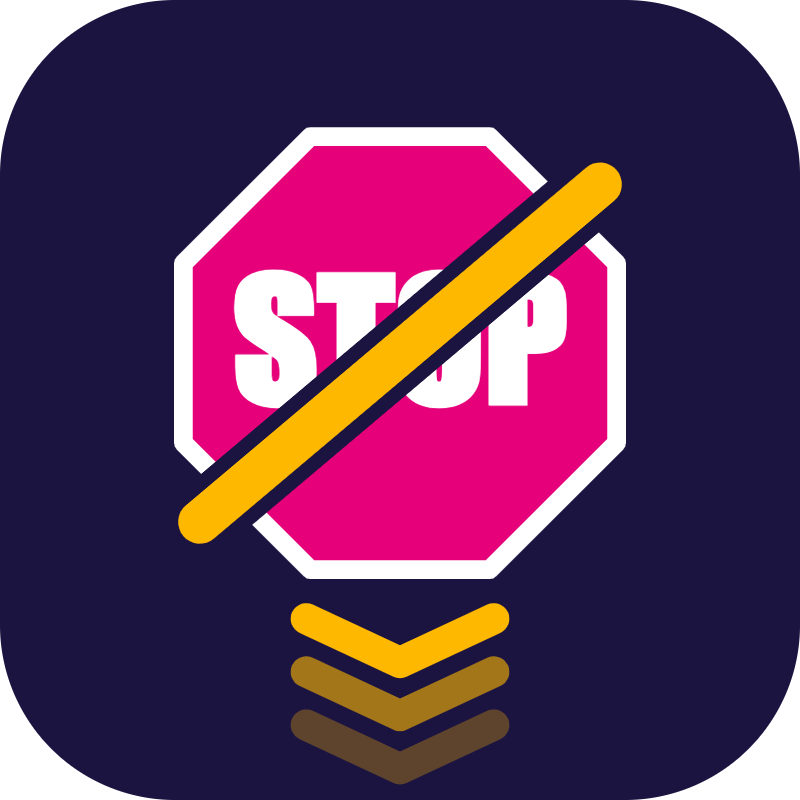

<div align="center">



# DONTSTOP

### Keep going. We’re watching.

**A sarcastic Android companion for the “one more Reel” loop.**

[](https://www.android.com/)
[](https://reactnative.dev/)
[](https://kotlinlang.org/)
[](https://github.com/sdm0p/DontStop/releases/tag/v0.1.0-beta.1)

[Download the Android beta](https://github.com/sdm0p/DontStop/releases/download/v0.1.0-beta.1/app-release.apk) · [Release notes](https://github.com/sdm0p/DontStop/releases/tag/v0.1.0-beta.1) · [Report a bug](https://github.com/sdm0p/DontStop/issues)

</div>

---

## The pitch

You opened Instagram for a minute. The next thing you know, your thumb has watched 87 Reels and your plans for the evening have quietly left the chat.

DONTSTOP keeps count. Set daily time and swipe limits for Instagram, YouTube, and Facebook; get increasingly sarcastic sound reminders; and let a little assistant peek in from the edge of the screen. The tracking runs in Android, so the dashboard can close while the counters keep working.

> **Beta honesty:** swipe counts are estimates based on Android accessibility events. Social apps and phone manufacturers can change those events or restrict background behavior, so results vary by app version and device.

## What it does

| Feature | What happens |
| --- | --- |
| **Time limits** | Counts foreground time in the social apps you enable. |
| **Swipe limits** | Estimates swipes in Instagram Reels, YouTube Shorts, and Facebook Reels. |
| **Escalating reminders** | Splits an allowance into milestones and plays a random clip from the matching sound category. |
| **Continuous mode** | Starts the continuous sound category after a configured limit is reached. |
| **Assistant ball** | A draggable face peeks in from the screen edge and shows app-specific usage when tapped. |
| **Daily history** | Stores local daily totals and a short usage history on your phone. |
| **Offline by design** | No account, backend, ad SDK, or cloud analytics. |

## Get the beta

1. Download **`app-release.apk`** from the [DONTSTOP v0.1.0 Beta 1 release](https://github.com/sdm0p/DontStop/releases/tag/v0.1.0-beta.1).
2. Open the downloaded APK on your Android phone and allow installation from that source if Android asks.
3. Open DONTSTOP and choose the apps and daily limits you want to track.
4. Grant **Usage Access**, **Accessibility**, **Display over other apps**, and **Notifications** when prompted.
5. Check that DONTSTOP reports tracking as active. Some Android manufacturers may also require allowing background activity in battery settings.

The beta is distributed as a direct APK; it is not on Google Play. Uninstalling DONTSTOP clears its local settings and permissions. Updating in place normally keeps them.

### Beta build details

- Android package: `com.dontstop`
- App version: `0.1.0` (version code `1`)
- Release tag: `v0.1.0-beta.1`
- APK size: about **31 MB**
- Release artifact: [`app-release.apk`](https://github.com/sdm0p/DontStop/releases/download/v0.1.0-beta.1/app-release.apk)

This is the October 10, 2026 build. It is published for early testing and does not include source changes made after that build. Audio volume, silent/DND behavior, sound routing, overlay persistence, and swipe detection can vary across Android versions and devices. DONTSTOP cannot guarantee overriding the phone’s system audio controls.

## Build it yourself

### Requirements

- Node.js **22 or newer**
- Android SDK and Android build tools
- A Java version supported by the included Gradle wrapper

### Commands

```powershell
npm ci
npm run typecheck
npm test
cd android
.\gradlew.bat assembleDebug
```

Build a release APK with:

```powershell
.\gradlew.bat assembleRelease
```

The APK is written to `android/app/build/outputs/apk/release/app-release.apk`. For local release builds, configure `android/keystore.properties` and keep the signing key and passwords private. The keystore files and local properties are ignored by Git. A build without a release signing key may produce an APK Android cannot install as an update.

## Sound categories

Bundled audio lives in these Android asset folders:

```text
android/app/src/main/assets/audio/gentle/
android/app/src/main/assets/audio/intermediate/
android/app/src/main/assets/audio/savage/
android/app/src/main/assets/audio/continuous/
```

Put `.mp3` files in the category they belong to. DONTSTOP picks clips randomly within that folder and avoids playing the same clip twice in a row when alternatives exist. Include only audio you have permission or a license to redistribute.

## Privacy, permissions, and limitations

DONTSTOP keeps settings and daily usage totals on the device. Accessibility access is used to recognize foreground apps and short-video surfaces; content is inspected transiently and is not saved. Usage access supports foreground-time accounting, and overlay access displays the assistant ball. See [the native privacy notes](android/NATIVE_PRIVACY.md).

The accessibility service needs to remain enabled for swipe tracking. Android may turn it off after reinstalling, an app update, or device maintenance. Time and swipe triggers are independent; swipe totals are estimates and aren’t guaranteed to match each physical gesture exactly.

## Project map

- [`SPEC.md`](SPEC.md) — product behavior and constraints
- [`DESIGN.md`](DESIGN.md) — interface and visual direction
- [`TASKS.md`](TASKS.md) — implementation checklist
- [`android/NATIVE_PRIVACY.md`](android/NATIVE_PRIVACY.md) — Android data boundary

## License

This repository currently has **no project-wide license**. That means the code is publicly viewable, but reuse and redistribution are not granted. Third-party dependencies and bundled audio may have separate terms.

<div align="center">

Made for the thumb that said “just one more.”

</div>
